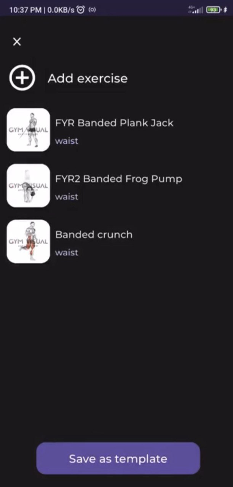
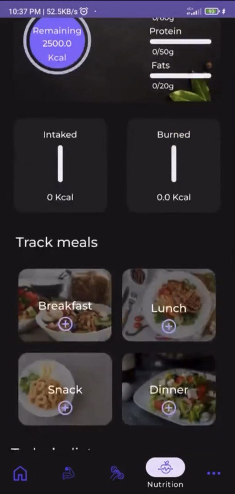
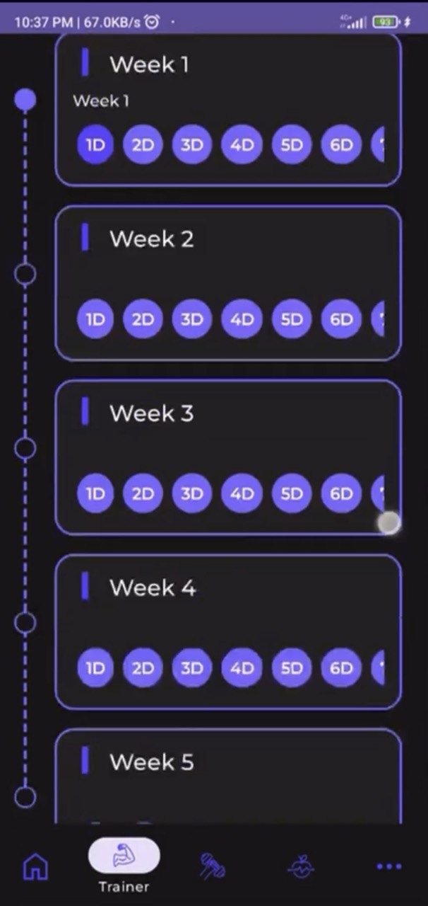
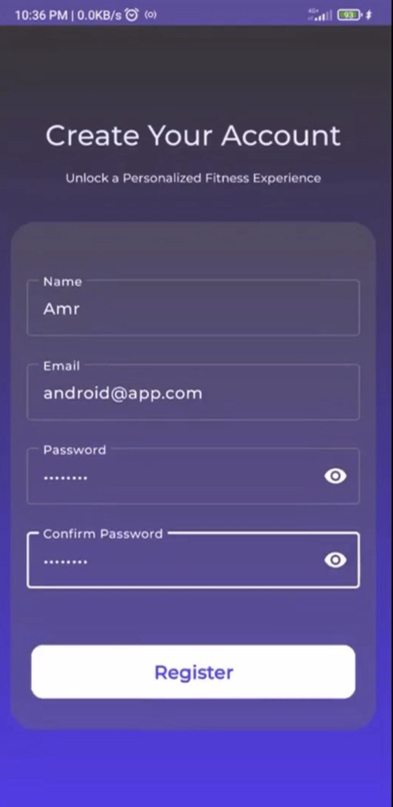
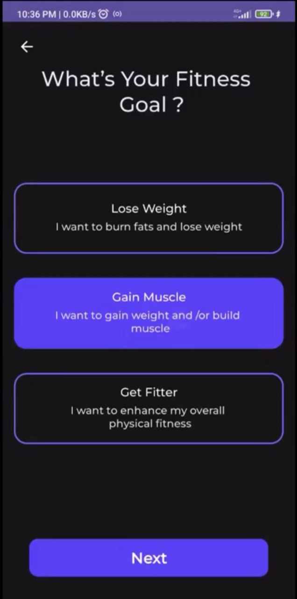

# Modarb — Fitness & Nutrition Android App

Modarb is a native Android application designed to help users
manage their workouts, nutrition plans and fitness goals.

The project was developed by a team of six computer science
students at Voronezh State University in 2025.

## Features

- User registration and authentication
- Personalized fitness profiles
- Workout programs and exercise library
- Weekly workout planning
- Custom workout routines
- Nutrition and meal planning
- Calorie and macronutrient tracking
- Fitness progress tracking
- Notifications and reminders
- Camera-based pose detection module

## App Screenshots

  
  
  

  
  

## Technology Stack

| Category | Technologies |
|---|---|
| Platform | Android |
| Languages | Kotlin, Java |
| User Interface | XML, Material Design |
| Architecture | MVVM, Clean Architecture principles |
| State Management | ViewModel, LiveData |
| UI Binding | View Binding, Data Binding |
| Networking | Retrofit, OkHttp |
| JSON Processing | Gson |
| Computer Vision | Google ML Kit |
| Camera | CameraX |
| Image Loading | Glide |
| Navigation | Android Jetpack Navigation |
| Build System | Gradle |
| Testing Tools | JUnit, Espresso |

## Project Architecture

The application is organized into functional modules with
separate data, domain and presentation layers.

    app/src/main/java/com/modarb/android/
    ├── network/
    │   └── models/
    ├── posedetection/
    │   ├── classification/
    │   ├── posedetector/
    │   └── Utils/
    └── ui/
        ├── helpers/
        ├── home/
        │   └── ui/
        │       ├── home/
        │       ├── nutrition/
        │       ├── plan/
        │       ├── workouts/
        │       └── more/
        ├── onboarding/
        └── workout/

## Technical Highlights

- Modular Android application architecture
- REST API integration
- Repository and use case patterns
- Reusable XML interface components
- Integration of pose detection libraries
- Camera lifecycle management
- Separation of presentation and business logic

## Getting Started

### Requirements

- Android Studio
- Android SDK 34
- Compatible JDK
- Android device or emulator (API 22 or higher)

### Installation

1. Clone the repository.
2. Open the project in Android Studio.
3. Synchronize the Gradle dependencies.
4. Configure an authorized and compatible backend URL
   in RetrofitService.kt.
5. Build and run the application.

## Project Status

This repository presents an academic project developed in 2025.

Some features depend on the availability of the original
backend service. The current build and runtime compatibility
have not been revalidated.

## Academic Context

- University: Voronezh State University
- Faculty: Computer Science
- Program: Software Engineering
- Year: 2025
- Project type: Team project

## My Contribution

Orphée Axel Oladjouhon BADA — Frontend Developer

- Participation in Android frontend development
- Work with Kotlin and XML interfaces
- Contribution to a collaborative software engineering project

The application was developed collaboratively.
Credit belongs to the original project team.
